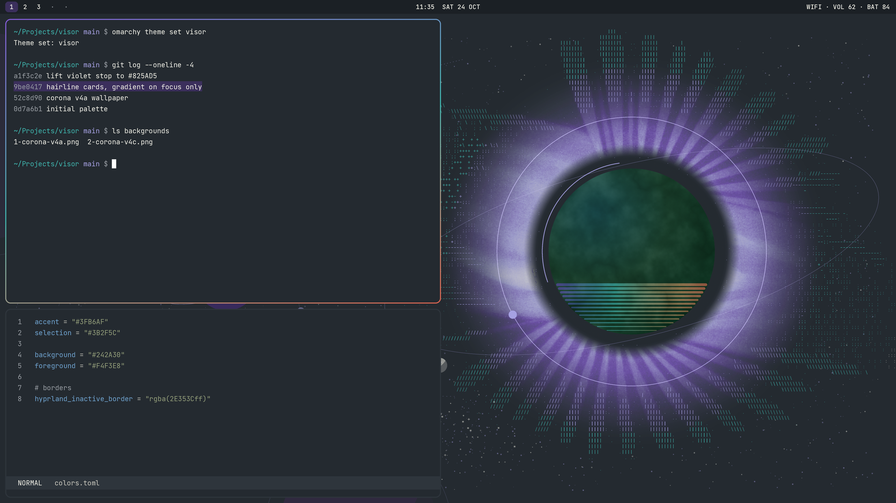

# Visor

A dark theme for [Omarchy](https://omarchy.org) 4. Charcoal background (`#242A30`), cream text (`#F4F3E8`), and colours taken from the visor of the Vedalken Dev helmet.



- Teal accents
- A violet, teal and coral gradient border on the focused window
- A 1px `#424A51` line around notifications, popups, menus, the launcher and password prompts
- Two Corona space wallpapers, in 16:9 and 16:10
- Yaru-prussiangreen icons

## Install

```
omarchy theme install https://github.com/vedalkenDev/omarchy-visor-theme
```

That gives you the colours, borders, wallpapers, icons and shell styling.

## Optional extras

Omarchy doesn't let a theme from GitHub change window settings or the lock screen, so these come as separate scripts. Run them from the installed theme folder:

```
cd ~/.config/omarchy/themes/visor
```

**Rounded corners and solid terminals.** Sets 10px corners, turns blur and shadows off, and makes terminals fully opaque.

```
bash extras/shape.sh            # turn on
bash extras/shape.sh --remove   # turn off
```

This stays on if you switch to another theme, so run `--remove` when you do.

**Font.** Visor is designed around Geist Mono.

```
omarchy pkg add otf-geist-mono-nerd
omarchy font set "GeistMono Nerd Font"
```

**Sharp lock screen.** Shows `lock.png` on the lock screen without blur, with the password field below it.

```
bash extras/lock/install-visor-lock.sh     # turn on
bash extras/lock/uninstall-visor-lock.sh   # back to Omarchy's lock screen
```

This makes a personal copy of Omarchy's lock-screen plugin and changes only how the background is drawn. Password checking is untouched. The catch is that your copy won't get Omarchy's lock-screen updates until you uninstall and reinstall it. If the patch doesn't match your Omarchy version, the script stops and changes nothing.

After installing it, check it once: run `omarchy-shell lock preview` (click to close), then lock with `omarchy system lock` and unlock with your password. If unlocking ever fails, press Ctrl+Alt+F2, log in, and run the uninstall script above.

`lock.png` is 1366x768. For a bigger screen, copy `extras/lock/lock-4k.png` (3840x2160) over `lock.png` in the theme folder and run `omarchy theme set visor` again.

## Zen browser

Omarchy doesn't theme Zen. In Settings, under Look and Feel, set the accent colour to `#3FB6AF`.

## Uninstall

```
bash extras/lock/uninstall-visor-lock.sh
bash extras/shape.sh --remove
omarchy theme set <another theme>
omarchy theme remove visor
```
